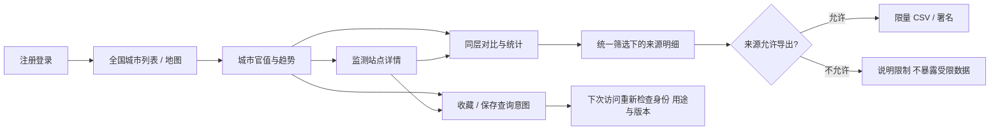
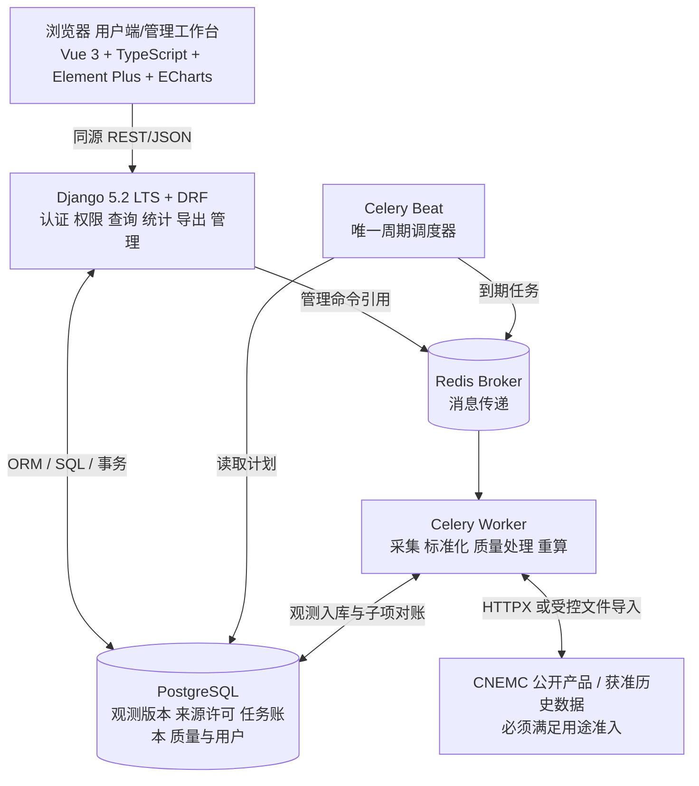
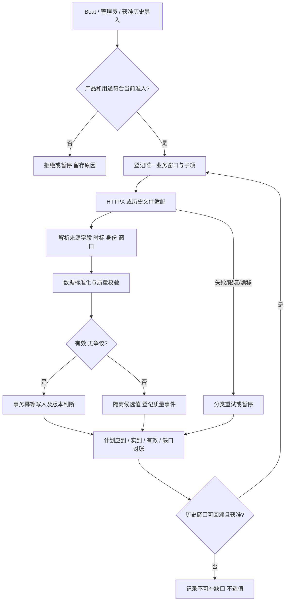
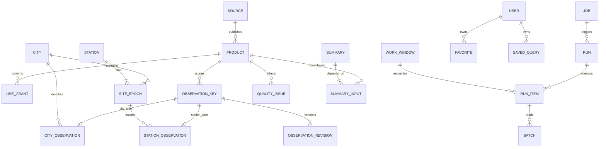

# 基于爬虫与可视化的城市空气质量监测数据分析平台

## 系统总体设计方案

| 文档属性 | 内容 |
|---|---|
| 文档版本 | **V3.0 · 最终整合版** |
| 设计基准 | 2026 年 11 月 20 日 |
| 项目性质 | 本科毕业设计 / Python 全栈工程项目 |
| 设计层级 | 系统总体设计（System Design） |
| 设计评审结论 | **APPROVED WITH CONDITIONS：总体设计有条件通过** |
| 运行准入结论 | **城市在线完整业务仍为 NO-GO**；技术取数可行不等于已获准持续采集、保存和展示 |
| 文档用途 | 独立指导任务书、开题报告、后续详细设计与系统验收；不依赖其他报告阅读 |

> **文档说明**：本文整合了第二阶段功能与架构方案、三轮可行性验证及设计审核后的成熟工程实践，直接给出系统应当如何工作、模块如何协作、数据如何判定和异常如何处理。本文是**待实现系统的设计规格**，不是“系统已开发完成”的报告。关键测试数据注明真实证据边界；尚未取得的数据使用许可、长时间外采和成品性能，不用设计假设冒充验证结果。本文不包含正式 SQL DDL、完整 API 路由清单、实现代码或 Sprint/开发任务分解。

---

## 1. 项目概述与设计边界

### 1.1 背景与定位

空气质量由空气质量指数（AQI）及 PM₂.₅、PM₁₀、SO₂、NO₂、CO、O₃ 六项主要污染物共同描述。官方实时页面能回答“现在如何”，但难以同时支持历史积累、跨城市比较、同城监测站点差异解释、采集异常追踪与个性化使用。直接展示抓取结果也不能保证结论可信：同城不同数据产品可能有不同时间和数值，数据缺失可能被误作“零污染”，任务完成可能仍缺一个城市的数据。

本平台以 **Python 自主网络采集**为入口，形成完整闭环：

**在线/历史来源 → 产品适配与采集 → 标准化、质量校验及修订 → PostgreSQL 规范化存储 → 统一查询与统计 → Vue/ECharts 可视化 → 用户操作与管理反馈。**

项目兼顾两个目标：一是完成可复现、可答辩的本科毕业设计；二是展现 Python 全栈开发、可靠任务处理、关系数据库、数据质量治理和交互式分析的实际工程能力。

### 1.2 建设目标

| 目标 | 设计结果 |
|---|---|
| 真实数据自主采集 | 在满足来源使用条件时，从 CNEMC 公开网页对应数据产品自动获取官方城市和站点观测；不依赖付费 API |
| 城市和站点双层业务 | 全国城市概览 → 城市详情 → 监测站点；可同层比较，不混合城市官值和站点均值 |
| 可积累的历史分析 | 保存获准的增量观测、导入获准历史数据，提供实际覆盖范围内的趋势和研究性统计 |
| 数据可信与可解释 | 显示来源、观测时间、统计窗口、单位、标准版本、有效样本与缺测状态 |
| 可管理的采集流水线 | 定时/手动任务、按窗口对账、幂等、重试、修订、补采条件与异常处理 |
| 完整用户应用 | 注册登录、查询、收藏、对比、统计、合规导出和管理员工作台 |
| 本地可靠交付 | Docker Compose、本地历史分析和断源演示，不要求公网或分布式集群 |

### 1.3 范围与明确不承诺事项

- **空间范围**：中国城市及其监测站点。全国概览展示某数据产品在选定时刻的**实际覆盖城市**，不假设所有城市数据、站点或历史都齐全。
- **时间范围**：最近一次观测、近 24 小时、已合法存储的小时历史，以及具备有效样本基础的月度/季节统计。全国多年完整小时库不是默认条件。
- **数据类型**：官方城市 AQI/六项浓度、站点 AQI/浓度，以及独立的官方趋势或日报产品。温湿度、风速等气象要素仅作为未来可选辅助，不取代空气质量主题。
- **用户范围**：未登录访客、注册普通用户和管理员；空气质量业务页面默认需登录，来源使用条件仍独立限制用户和管理员。
- **部署范围**：单机本地开发与毕业答辩，前后端分离；不承诺生产公网 SLA、多租户、移动传感器接入和跨机高可用。
- **暂不纳入核心**：AQI 预测、AI 生成报告、健康诊断、复杂预警、社交、第三方登录、通用分布式爬虫、微服务、Kafka、独立搜索/时序引擎与 Kubernetes。

### 1.4 设计原则

1. **产品分明**：全国 AQI 列表、单城市直接发布实况、按城市站点、近 24 小时趋势、官方日报和历史研究数据分别识别；相同城市、相同小时不等于同一发布产品。
2. **结果有据**：每条可展示值都能够说明实体、来源、产品、观测时间、单位、统计窗口、质量状态和使用范围。
3. **缺测不造值**：历史空窗就是空窗；“最近有效”只用于明确选择的最新视图，不能为指定区间补时槽。
4. **一切统计有分母**：先判断观测是否可比和样本是否充分，再提供整期差异、相关性或排名。
5. **数据库是事实账本**：队列可以重复投递；窗口唯一性、观测版本和任务最终状态由 PostgreSQL 的事务与约束保证。
6. **最小必要架构**：用 Django 模块化单体和已验证组件解决问题；新增中间件必须有真实收益。
7. **使用权限贯穿全链路**：公开网页可访问不等于允许定时抓取、长期保存、公开展示或原始导出；不同用途逐项判断。

### 1.5 现有证据与尚未验证的范围

以下数值仅说明**三轮原型和审核材料所支撑的事实**，并非成品能力或长期保证。

| 事项 | 已有证据 | 不能外推为 |
|---|---|---|
| 基础技术链 | 首轮 18 项中 15 PASS、2 PARTIAL（站点和离线展示）、1 BLOCKED（城市在线）；Django、DRF、PG、Celery/Redis/Beat、Vue/ECharts、Compose 在限定原型中运行 | 正式产品的十模块均已实现 |
| 历史数据分析 | UCI 北京 12 站、2013-03 至 2017-02，420,768 行，CC BY 4.0；站点历史小样与数据库进行了指标对账 | 内地全国城市 AQI 历史或实际站点完整地理沿革 |
| 站点在线采集 | 第二轮香港环保署两次真实请求，18 站×24 小时的窗口推进；小样通过 Celery/PG/ORM | 内地三地区城市数据或全面数据使用授权 |
| CNEMC 城市取数 | 第三轮浏览器与独立 HTTPX 确认京沪穗城市官方 AQI 和六项浓度为**直接发布的城市对象**；全国列表一次返回 338 城码，按城站点京沪穗分别 23/19/20 行；十组七项文本对账一致 | 所有城市永久覆盖、单城请求可无限轮询、全国多年数据齐全 |
| 两期与一致性 | 浏览器三城观察过两个小时；独立 HTTPX 京沪跨期，广州仅一期；10/10 组七项文本相符，7/10 组整包指纹一致 | 广州 HTTPX 跨期已完成，或三份指纹不同就必然发生源方修订 |
| 可靠性与性能 | Worker 重投、幂等、历史数据入库、百万合成记录索引效果有实测；部分故障为合成注入 | 真实源方修订已发生，千万行并发 HTTP 达标，已自然运行 168 小时 |

**当前决策**：总体设计有条件通过，允许不依赖未明确授权在线数据的基础详细设计及获准历史/合成数据开发。**CNEMC 周期采集、必要持久化、展示、导出和城市在线正式验收仍须另行放行**，不因本文完成而改变。

---

## 2. 用户、权限与总体业务结构

### 2.1 角色与权限边界

| 功能 | 未登录访客 | 普通用户 USER | 管理员 ADMIN |
|---|---|---|---|
| 平台说明、注册、登录 | 可访问；注册只能获得 USER | 登录/退出、改密 | 管理账号受控创建 |
| 全国、城市、站点及历史查询 | 不可访问 | 可查看**来源允许其查看**的记录 | 同样受来源用途约束 |
| 比较、统计、查询 | 不可访问 | 可操作允许范围内的数据 | 可操作允许范围内的数据 |
| 收藏和分析方案 | 不可访问 | 仅本人的对象和查询意图 | 仅本人；无默认权限浏览他人私有配置 |
| CSV 或汇总导出 | 不可访问 | 仅在对应产品明确允许下载的范围内 | 管理员身份不自动授予数据再分发权 |
| 定时/手动任务、补采、质量裁决 | 不可访问 | 不可访问 | 经来源授权、权限检查并保留审计后操作 |
| 用户管理、基础字典、运行状态 | 不可访问 | 自己的资料 | 受控管理，不得直接修改官方观测值 |

注册的业务价值在于**有归属的关注、私有分析设置与受限导出**，不是为开放数据添加没有意义的登录墙。用户角色授权和**数据来源授权**为两套独立判断；通过前者不代表自动通过后者。

### 2.2 十个一级模块及优先级

固定为**七个用户端模块、三个管理员模块**。P0 表示必须设计并计划交付的核心能力；P1 表示体现深度的增强；P2 为可选扩展。P0 **不意味着相应来源已经准许正式运行**。

| 编号 | 模块 | P0 主要能力 | P1 主要增强 |
|---|---|---|---|
| M01 | 全国空气质量总览 | 全国 AQI 同刻地图/城市列表、筛选、等级分布、排名、下钻城市 | 地域筛选、基于相同对象交集的时刻变化比较 |
| M02 | 城市空气质量详情 | 官方城市 AQI 与六项浓度、观测时间、近期 AQI、已存历史、站点入口 | 月/季变化、站点差异摘要 |
| M03 | 监测站点详情 | 站点身份/站址、各指标最近有效值、指定窗口历史、数据新鲜度 | 覆盖日历、站点异常与迁址说明 |
| M04 | 城市与站点对比 | 多城市或同城多站的同质指标和对齐时序比较 | 共同有效时槽的差值、变幅与覆盖说明 |
| M05 | 综合统计分析 | 时间分布、趋势、浓度统计、有效样本数和缺测情况 | 季节性、箱线图、热图、相关性及异常分析 |
| M06 | 数据查询与导出 | 多条件查询、分页、来源明细、按许可受限 CSV 导出 | 自选字段、经许可的汇总导出 |
| M07 | 用户账户与个人中心 | 注册登录/改密、资料、城市/站点收藏和我的关注 | 保存分析条件、个性化回访界面 |
| M08 | 数据采集与任务管理 | 定时/手动/导入、运行/窗口账本、重试、互斥、完整性对账 | 有条件的历史补采、运行指标趋势 |
| M09 | 数据质量与数据管理 | 单位/缺测/异常检查、修订处理、质量事件、站址和来源管理 | 覆盖率看板、受影响统计重算、批量复核 |
| M10 | 系统管理与运行监控 | 账号和基础配置、系统健康、任务和源状态、管理审计 | 运行趋势与运维辅助 |

### 2.3 三条核心用户链路

**链路 A：普通用户观察与分析。** 注册登录 → 全国城市列表/地图 → 城市官方七项指标及近期趋势 → 站点列表/详情 → 选同层对象比较 → 查看统计覆盖及原始明细 → 收藏或在获准范围内导出。

**链路 B：管理员采集与治理。** 查看产品使用状态、计划窗口及待到数据 → 启动获准定时/手动/文件导入 → 适配与质量校验 → 数据库对账“应到/实到/新增/重复/修订/隔离/缺失” → 发现问题定位批次、子项与观测版本 → 有依据地裁决或记录无法补采的缺口 → 用户界面显示可靠状态。

**链路 C：研究性分析。** 选择城市或站点、产品、指标与时间窗口 → 计算有效样本和可比时槽 → 仅在条件充分时显示整期比较、相关性或季节结论 → 图表可跳转到相同条件的明细 → 保存查询意图，下一次打开重新鉴权和校验口径。

---

## 3. 功能模块详细设计

本节说明各模块**提供什么、从哪里读、如何交互、出问题时如何表现**。所有查询、表格、图表和导出共用后端的产品选择、时间、质量与权限规则，避免在各页面重复计算同一业务结果。

### M01 全国空气质量总览

**定位**：用户发现当前有数据覆盖的城市，并从宏观 AQI 分布进入单城市。以 CNEMC 全国城市 AQI 列表产品（下文 L）为默认权威来源。

- **P0**：地图与城市列表、搜索和地域筛选、AQI 数值与等级、首要污染物、同一产品/同一观测时刻的排行与等级分布、覆盖城市数和实际观测时刻；城市点击下钻 M02。
- **业务规则**：不能把每座城市“各自最新”的不同观测时刻拼成“全国某一时刻”排名；不能把全国列表的污染物等级数字当六项浓度；不能用站点插值或全国平均 AQI 填空白地区。只对本次实际覆盖、可比较的城市统计。
- **空态**：未覆盖、来源过期、特定时刻缺数、无展示权分开提示；地图几何/坐标尚无合法依据时保留城市列表及搜索功能，但不把列表可用算作地图验收通过。
- **P1/P2**：省份/地域对比、两期同城差值排行；历史地图回放仅在存在同产品历史记录、合法地图数据和足够覆盖时启用。

### M02 城市空气质量详情

**定位**：解释“这座城市的官方空气质量状况以及可合法查询的历史变化”。

- **P0**：来自单城直接实况（C）的 AQI 和六浓度指标卡、空气质量等级/首要污染物、真实观测时刻及采集时刻；来自近期趋势产品（T）的最近 24 小时 AQI；已存 C 产品历史查询；该城市所属站点列表，点站进入 M03。
- **产品边界**：L、C、T 和可选日报 D 可以在界面上并列，但不能互相补列、静默覆盖或重复计为一条“城市历史”。例如 L 有 AQI 但 C 的六浓度缺失时，显示“全国列表 AQI（另一产品）”，六浓度保持空；T 不自动拼进 C 历史长序列。
- **时间规则**：每个指标均随来源和 `observed_at` 呈现，过去 7/30 天按钮只在对应授权记录确有覆盖时提供，不承诺上游能任意补采。城市站点差异仅使用可比的浓度，不把站点值重算为城市官方 AQI。
- **P1**：基于已存合法历史的月季趋势、站点空间差异摘要与数据覆盖解释。

### M03 监测站点详情

**定位**：解释特定站点的真实观测、历史、身份和数据缺失。

- **P0**：站点原码/来源命名空间、名称、归属城市、站址有效期、获准且已核坐标；指标 AQI 与污染物浓度、独立观测时刻、最新有效记录、按用户指定范围的历史曲线和明细、数据新鲜度与收藏入口。
- **最近有效与历史空窗分离**：默认“最近有效”模式可为不同指标展示**各自不同**的最后有效时刻和观测年龄，但不得跨来源、跨产品、跨统计窗口或未经证实的站址期合并。用户明确查询昨天 12:00，该小时没有数据必须返回空，不能填入今天 10:00 的数值。
- **站点身份**：没有正式站码的历史研究站点使用带来源的内部 ID；同名、近邻或今天坐标相似不自动证明同一站。迁址前记录不冒充新址现况；无合规坐标时列表和趋势仍可工作。
- **P1**：覆盖/缺测日历、异常时段、与可比同城站点的浓度差异说明。

### M04 城市与站点对比

**定位**：回答“同一时刻或同一研究窗口，几个可比对象相差多少”。

- **P0**：明确选择**多城市 C 对 C**、或**同一城市内 S 对 S**、或同一合法历史研究集 H 内已证实同城的站点；对象数、时间范围、指标、粒度及来源产品可见；图表和明细时间轴对齐。
- **可比规则**：层级、产品语义、指标、统计窗口、单位、质量状态和标准版本必须兼容；缺项显示缺测，不使用最近值填同期。跨层的“城市与某站”可以并列解释同指标浓度，但不生成混合排名。
- **整期结论**：比较一段时间的高低或变化幅度，必须使用**共同应有窗口内共同有效样本**，不能用两个对象各自的平均值和各自覆盖率直接得出“全天排名”；共同覆盖不足时保留时序图与配对样本说明，不给整期排名。
- **P1**：共同样本差值、变化幅度、差异图和可解释的样本覆盖标签；可与 M07 保存查询意图。

### M05 综合统计分析

**定位**：帮助用户识别真实浓度数据中的时间、空间与指标关联模式，而非堆砌图表。

- **P0**：同质记录的小时变化、分日/分月浓度探索性统计、均值/极值/中位数/分布、有效样本数、应有时槽、缺测与异常标识；图表可下钻到 M06 明细。
- **P1**：季节性、箱线图、时间热力图、同城站点差异、污染物相关性（有充足成对样本时）、异常候选识别。季节结论须标明季节覆盖范围、完整月份和站址/标准分段。
- **严禁**：把小时 AQI 求平均冒充官方日报，把稀疏浓度分布写成城市法定达标率，把不同标准版本或不同统计窗口混排为统一指数，把相关性说成污染物因果关系。
- **输出原则**：每个分析结果必须同时给出时间范围、对象、指标、单位、算法、样本有效性与缺测解释；没有足够数据时应允许用户看明细，但提示“样本不足，不生成整期结论”。

### M06 数据查询与导出

**定位**：为统计和图表提供可追溯的观测证据，并在允许范围内提供数据文件。

- **P0**：按城市/站点、来源产品、指标、观测时间、状态和标准版本组合查询，稳定分页；表格至少体现数值、单位、观测时刻、采集时刻、来源、统计窗口与质量提示。接受 M04/M05 带入的同一查询条件。
- **授权分离**：查看、生成统计、导出明细、导出汇总是不同用途；展示已获准不推定原始 CSV 分发获准。导出前与实际下载时都重新检查本人权限、来源产品/受众/字段/行数及当前数据版本。
- **CSV 约束**：默认小范围、带来源及署名、时间时区、指标/单位/窗口、质量和生成时间/版本；防止电子表格公式注入，不含未获准原文和个人信息。来源撤权或统计版本失效时，旧下载件不得继续提供。
- **P1**：字段选择和获准汇总导出；超出系统预算时要求缩小范围，不预先建设异步文件分发平台。

### M07 用户账户与个人中心

**定位**：支持身份隔离、收藏对象和可重复使用的个人分析意图。

- **P0**：注册、登录、退出、修改密码、个人资料、城市和站点收藏、我的关注与最近获准数据摘要。收藏键以本人＋稳定对象身份唯一，不能重复创建同一目标。
- **回访行为**：关注站点停运或更名后保留原身份并显示“已停用/待核”，不得静默改为同名新站；来源展示权撤回时保留用户意图但隐藏受限数据。
- **P1**：保存筛选条件、对象、时间锚、粒度、算法等**查询意图**，而不是复制第三方观测快照。下次打开重新鉴权、重新查询、校验来源与统计版本；有变化时提示，不偷偷改源或日期。
- **P2**：关注排序、个人视图优化；不建设独立消息平台作为核心能力。

### M08 数据采集与任务管理

**定位**：让管理员能够回答“计划抓哪些、实际取到哪些、为什么失败、是否补齐”。

- **P0**：来源和产品配置、获准周期任务、管理员手动触发、受控历史导入、运行/子项/窗口账本、重试和暂停、互斥、重复防护、覆盖与缺口对账。任务展示“成功产生新观测、请求成功但无新发布、部分成功、失败、暂停/拒绝”等不同结果。
- **核心约束**：定时、手动和重试争用同一业务窗口，数据库负责唯一性与认领；源方只有当前数据时，不能用新的实况包“补回”昨天的时槽；没有许可、明显限流或请求结构改变要暂停，而不是更换身份绕过。
- **业务联动**：运行问题可定位到批次、子项、质量事件（M09）及受影响的用户查询；日志里要区分“HTTP 成功”“出现新观测”“该窗口覆盖完整”。
- **P1**：只在源方支持且获准时补采历史，提供任务时延、质量与成功率趋势；不引入通用分布式调度集群。

### M09 数据质量与数据管理

**定位**：识别、解释和处置影响数据可信度的问题。

- **P0**：来源产品元数据与字段契约、缺失/无效单位/重复/结构漂移/冲突/时间异常检测；站点身份和有效期管理；质量事件有严重程度、影响对象/字段/窗口、原批次/运行、处理状态、证据和处理人。
- **修订裁决**：官方观测值不可由管理员直接随意改写；只有可信的新来源版本才晋升当前值，无顺序异值必须保留争议并隔离。修订确认后影响范围内旧汇总、缓存和预生成文件失效，按当前许可重算。
- **数据缺口**：上游未报、本站未获取、源方无该项、字段异常和来源撤权分别标记；不能因为无法补采就将缺口删除，也不能把异常高峰一律当错误数据删掉。
- **P1**：完整率与问题趋势、可重算汇总、批量复核辅助；撤权屏蔽和错误修订防护不因列为增强而放弃。

### M10 系统管理与运行监控

**定位**：保证本地服务、账号及管理员业务操作可控。

- **P0**：账号启禁、管理员权限、受限字典、运行健康与错误摘要、任务积压、最近新观测时刻、管理审计。Web、PostgreSQL、Redis、Worker/Beat、来源端应分开显示健康状态。
- **后台分工**：Django Admin 管账号与低风险基础实体，Vue 管理工作台负责采集、质量、运行和受控的高影响业务动作。两者不能提供绕开来源权限或直接修改官方观测的“万能 CRUD”。
- **异常表达**：数据源失败不能被表示为整站宕机；没有监测证据不能显示“服务正常”；账号停用后会话与管理权限应及时失效。
- **P1**：运维趋势、受控重置及必要管理员操作审计，不另行建设复杂监控平台。

---

## 4. 页面与交互设计

### 4.1 页面信息架构

**普通用户导航**：全国概览｜对比分析｜综合统计｜数据查询｜我的关注/个人中心。城市/站点详情为可返回原筛选上下文的下钻页，不另建一套重复的全国统计门户。

**管理员附加导航**：采集任务｜数据质量｜系统运行；身份及基础字典维护通过受控 Django Admin 完成。

| 页面 | 主要区域 | 关键交互与规则 |
|---|---|---|
| 全国概览 | 顶部观测时间/来源/实际覆盖数，地图和可搜索城市表，等级分布与同刻排行 | 地图与表格同步选中城市；地图不合规时保留列表下钻，但地图不得记为正式完成 |
| 城市详情 | 名称、C 产品七项指标、各自时间与状态；T 的近期 AQI 曲线；C 的已存历史；站点表/地图 | 不同产品单独标注；选时段联动明细，不把 T 与 C 混成一个计数系列 |
| 站点详情 | 站点身份与站址期、最新有效面板、指定窗口趋势与明细、覆盖提示 | 最新有效逐指标标注年龄；显式窗口无记录保持空；无坐标退化为列表 |
| 城市/站点对比 | 选择对象与统一指标/产品/时间的筛选条、时序与同刻图、对齐表和共同覆盖率 | 切换层级清除不兼容筛选，整期结论受共同有效时槽限制 |
| 综合统计 | 时间分布、箱线/季节/相关性、方法说明、样本计数、支撑明细入口 | 缺失数据不断点造线；不达展示门槛仍能看数据和不足原因 |
| 数据查询 | 对象/时段/质量筛选、稳定分页、来源字段、受限导出 | 预览与下载分别鉴权；版本变化使已生成文件失效 |
| 我的关注 | 收藏清单、最近获准摘要、已停用/来源受限标记、保存的分析条件 | 保存意图不保存测值；再次访问执行新查询与许可检查 |
| 管理工作台 | 任务计划、运行结果、窗口覆盖、质量事件、服务健康 | 一条问题可追到 Run、子项、批次、观测版本和处置记录 |

### 4.2 统一查询与图表交互

页面共同管理的选择条件为：**对象层级/对象、数据来源产品、指标、单位、时间范围及锚点、统计粒度、标准/质量条件**。图表、数据表和导出必须引用同一语义的查询结果，不能分别在前端自行筛选以制造不同口径。

- “最近 24 小时”必须展示参考时刻（当前本地时间还是最后可用观测时刻）；绝对时间区间按产品的来源时区解释，转换和显示规则一致。
- 切换城市、站点或条件时，较早的异步响应不得覆盖当前条件下的新查询；保留返回位置与有效筛选。
- 趋势折线在缺测段**断开**，不能跨空窗连成连续观测；数据降采样仅改变绘图点数，不改变统计计算与 CSV 来源。
- 加载中、指定窗口无记录、尚未覆盖、数据陈旧、采集失败、结构异常和无展示权是不同页面状态；有权显示的旧值必须标时，失去展示权时不能继续作为“缓存旧值”显示。
- 地图之外始终保留可搜索列表、表格和键盘可操作入口；AQI 等级使用文字与颜色共同表达，兼容窄屏和基础无障碍阅读。
- 本地答辩默认不依赖外部 CDN；地图几何、图标、字体必须具有相应使用条件，坐标系核实前不绘制所谓真实点位。

---

## 5. 系统总体技术架构

### 5.1 架构形态

采用**Vue 前后端分离 + Django/DRF 模块化单体 + 独立 Celery 任务进程 + PostgreSQL/Redis**。数据库保存业务真相，队列只负责异步投递；浏览器的每次查询只访问已存且可展示的记录，**不让用户请求直接轮询外部 CNEMC 官网**。

这里的 Web、Worker、Beat 是同一业务项目的不同运行进程，不拆成独立微服务。应用内按领域分层，重用统一的产品/许可/质量规则；Redis 不承担当前值、用户角色、任务终态或可靠历史数据的持久事实责任。

### 5.2 主要技术选型

| 层级 | 技术 | 职责和理由 | 当前不引入的替代 |
|---|---|---|---|
| 语言与环境 | Python 3.13、uv、Ruff | 统一 Web、爬虫、数据分析语言；依赖锁定、静态检查 | 第二套常驻运行语言与复杂多构建系统 |
| 业务后端 | Django 5.2 LTS、DRF、Django ORM/Migrations、Django Admin | 认证、会话、权限、领域服务、迁移、基础后台 | 不重新选 FastAPI，不自建完整 Auth/ORM |
| 网络采集 | HTTPX + JSON/CSV/XML 必要解析 | CNEMC 当前为结构化 HTTP 请求，便于连接复用、限时与字段契约校验 | Scrapy 仅在有真实批量网页抓取需求时引入；不常驻浏览器 |
| 周期任务 | Celery Worker、Celery Beat、django-celery-beat、Redis | 周期配置、异步执行、有限重试；PG 保存业务任务账 | 不用 Redis 当观测库，不上 Kafka/任务集群 |
| 数据库 | PostgreSQL | 数据关系、事务与唯一键、时序过滤、批量写入、SQL 聚合 | 没有性能依据不加 Elasticsearch、TimescaleDB、额外时序库 |
| 统计 | SQL + Pandas/NumPy | SQL 负责筛选、分组和计数；受限数据子集用 Pandas 进行相关性/季节统计 | 不全表拉入内存、不引入预测服务 |
| 前端 | Vue 3、TypeScript、Vite、Vue Router、Pinia、Axios、Element Plus | 页面/路由、筛选状态、表格表单、同源 API 调用 | 不重复做两个管理后台或独立前端状态框架 |
| 图表 | ECharts + 获准地图素材 | AQI 地图、趋势、分布、散点、热图与下钻 | 不未经许可接商业底图，不把示意图算真实地图 |
| 质量与部署 | pytest/pytest-django、Vitest、Playwright、Docker Compose | 单测、端到端与单机可复现部署 | 不预设 Kubernetes 或公网 SLA |

Chrome DevTools 与 Playwright 已用于验证网页请求、浏览器交互；**正式网络采集不依赖浏览器驻留**。API 说明可通过 OpenAPI/drf-spectacular 生成，但当前总体设计不定义逐条实现路由。

### 5.3 后端领域责任边界

| 领域 | 主要责任 | 不应承担的责任 |
|---|---|---|
| 账户与个人业务 | 会话、角色、资料、收藏、私有分析配置 | 不越权返回其他用户配置或缓存第三方测值 |
| 来源与地理目录 | 数据来源/产品字典、许可、城市编码、站点站址期 | 不凭名称自行合并两个来源的站点 |
| 观测查询 | 固定产品系列、时窗和质量，提供最近有效/历史、稳定分页与来源信息 | 不在页面请求中临时抓取外网，不拼接不同产品作一份历史 |
| 分析 | 同质时槽对齐、SQL 汇总、Pandas 受限计算、方法与分母 | 不生成未经证实的官方日报或城市达标率 |
| 任务与采集 | 计划/窗口/运行/子项、来源适配、重试和补采条件 | 不凭任务返回码宣称数据齐全 |
| 质量与修订 | 字段/身份校验、冲突裁决、版本晋升、派生失效 | 不裸改官方观测或静默删除异常峰值 |
| 导出与运行 | 用途+所有权复核、限量导出、健康和审计 | 不借管理员身份绕过来源授权 |

**接口的统一语义**：成功结果需说明当前查询条件、产品/来源、对象、指标、单位/窗口、观测时间、质量/新鲜度、数据覆盖与分页；无数据是明确的空集合，权限拒绝、参数错误、来源不可用和系统故障有不同状态。前端不能凭 API 返回中的某个值猜测其产品、时间或单位。

---

## 6. 数据产品与自主采集设计

### 6.1 数据产品目录与选用规则

下表来自 2026-11-20 附近的 CNEMC 真实网页请求核查。**这些是当时网页使用的 HTTP 路径，并非官方承诺持续兼容、允许任意使用的开放 API。**“已验证”只指限定浏览器/HTTPX 样本。

| 产品 | 当时观测到的数据请求 | 返回语义 | 固定业务用途 |
|---|---|---|---|
| **L：全国城市列表** | `GET /CityData/GetAllCityRealTimeAQIModels` | 城码、AQI、等级、首要污染物、地图信息等；六个 `*Level` 是等级，不是六项浓度 | 全国总览、相同产品同刻等级分布和排名 |
| **C：单城直接实况** | `POST /CityData/GetAQIDataPublishLiveInfo?cityCode=…`，空正文 | 按城市码直接发布城市 AQI 与六浓度、观测时刻 | 城市七项指标、该产品后续合法积累的历史、同类城市浓度比较 |
| **S：按城站点实况** | `GET /CityData/GetAQIDataPublishLive?cityName=…` | 站点码、归属、站址、站点 AQI 和各污染物及自身观测时间 | 站点详情和站点同产品趋势/比较 |
| **T：城市近期趋势** | `POST /HourChangesPublish/GetCityRealTimeAqiHistoryByCondition?citycode=…`，空正文 | 近 24 小时 AQI 序列，三城有页面对账 | 城市近期 AQI 图；不推定任意历史回补能力 |
| **D：官方城市日报** | 官方日报的可识别产品，具体接口与每字段待独立核验 | 城市报告日与官方日产品；存在有限查看证据 | 独立日报展示，不能由小时 AQI 均值伪造 |
| **H：获准历史站点** | 例如 UCI 北京多站点 CC BY 4.0 历史文件 | 逐小时历史浓度；无官方城市 AQI、正式站码与坐标 | 北京站点研究统计与合法离线演示 |
| **F：合成夹具** | 项目自制测试数据 | 可构造空窗、冲突和各种异常 | 软件测试/演示，**独立命名空间和明显标记**；不进入真实观测统计或在线验收 |

还可能存在全国站点地图/单站趋势/污染物分指数产品，但仅完成字段、单位、时窗和许可核实后作为**独立产品**接入；不能因为接口 URL 类似便自动与 S 合并。香港环保署站点数据的内部验证使用范围不转移给内地城市产品；QuotSoft、地方数据按产品单独评估。

**查询产品选择是明确的设计规则**：M01 只读 L；M02 七项只读 C，近期 AQI 独立读 T；M03 默认读 S 或独立 H；M04 多城市以 C 对 C、同城站点以同类 S 对 S 或 H 对 H；官方日报只读 D；M06/M05 在页面和结果中保留产品身份。一座城市在 L、C、T 同小时出现三个 AQI 值时，**分别展示、单独对账、不得互盖或统计重计**。

### 6.2 采集范围与历史覆盖

- **全国 AQI 概览**：在来源允许条件下，优先以一次全国列表产品获取可见城市，并按列表时刻形成总览，不对每座城市额外开一次无必要的外网请求。
- **城市浓度**：按城码获取 C 产品；先验证重点城市可持续和样本完整性，再在准入配额允许的情况下扩大地域覆盖。一次 338 城码不等于 338 城每小时七项都可稳定持久采集。
- **站点数据**：优先按城批量或已核全国站点产品获取，保留站点原码、区域归属和站址有效期；不把站点当前地理元数据覆写进所有旧小时记录。
- **历史数据**：仅由明确获准的历史文件或之后合法积累形成；近期 T 序列不是自由回溯所有历史日期的证明。
- **更新频率**：技术上支持小时级，但实际访问周期、并发、错峰、请求预算、重试和保存期限以来源条款为先；未明确允许前**不启用 CNEMC 的周期任务**。
- **用户请求**：只查 PostgreSQL 中允许保留和展示的数据。外部接口无法访问时，应显示有权使用的本地旧观测及其时间，不能请求时偷偷退回到其他来源或旧窗口。

### 6.3 来源许可作为运行规则

每个数据产品登记：发布者、适用公开条款/授权证据及版本、地域和产品范围、允许的请求频率、数据保存期限、使用受众、生效/终止日期及撤回条件。**动作独立判断**：自动获取、规范化保存、原始响应保存、校内非商业演示、公开展示、统计与截图传播、原始或衍生 CSV 导出、备份与恢复。

**默认拒绝未确认用途**，不把代码仓库 MIT/AGPL 等许可证当作观测数据许可，也不因为官网网页能看就推断可以长期镜像。多来源汇总或文件导出必须取涉及来源用途的许可交集；只有某一种导出不获准时，关闭该种导出，不必连带禁用已获准的内部统计。

许可要在**计划/投递、实际访问、入库、业务读取、统计/导出、文件下载和备份恢复**这些关键边界复核。来源授权到期或撤回时，按失效用途停止相关自动任务和重试，屏蔽受限的观测与派生结果，停用受影响的预生成导出链接并清除相应缓存。**仅展示权失效时**，按其余有效权限继续留存和使用数据。

**数据留存期限届满或留存权被撤回时**，按适用许可、法律义务和受影响范围删除、不可逆匿名化或采取其他明确允许的处置方式，覆盖受同等留存限制的规范化观测、原始响应、修订记录、派生数据、缓存、可控导出副本及备份。未受影响且仍有有效保存依据的数据继续留存，已下载副本的处置以平台实际控制范围为限。处置审计仅保留来源、影响范围、处置时间、结果等最小必要信息，不保留无权留存的观测内容。

**备份适用同一留存约束**。无法立即逐项处置的备份，仅在有明确留存依据时隔离留存并限制访问和恢复，最迟在适用留存期限届满时删除或按明确允许的方式处置。无继续留存依据时立即处置。需要整份处置时，在适用期限内保全未受影响且仍获准留存的数据。恢复旧备份需先隔离，依据备份之外的**现行许可与撤回记录**复核并排除无权留存的数据，无法排除时拒绝恢复。

若没有原始响应留存权，不保存可还原整包数据的日志、截图或原文；必要的摘要与哈希也应审查是否符合对应使用范围。许可约束和采集技术可行性是两条独立证据链。

### 6.4 自主采集与质量处理流程

**来源适配器职责**：只负责一个产品的 URL/请求规则、连接与超时、响应形状、时间解析、字段映射、限流与错误分类；输出标准化候选记录和批次信息，不处理用户收藏、管理权限或直接修改正式观测。导入器同样检查来源、文件大小、字段、行数、时区与批次指纹，不允许文件内容定义任意远程访问地址。

### 6.5 调度、窗口互斥、可靠投递和补采

**业务对象分离**：`Job`（任务配置）→ `WorkWindow`（来源/产品/对象范围/目标时间的唯一业务窗口）→ `Run`（一次触发或执行）→ `RunItem`（稳定子项的一次尝试与状态）→ `Batch`（一次获取/解析证据）。定时、手动和重试可以触发同一业务窗口，但不能生成多个独立“完成事实”。

- **唯一业务键**：同一产品、地理对象或稳定分片、时间窗和回溯方式对应一个业务窗口。任务触发来源和 Worker ID 不进入此键。
- **认领与过期回收**：数据库事务认领子项；使用可过期租约和所有者代次，防止超时 Worker 恢复后覆盖新执行者已提交结果。只有当前所有者/代次可提交有效子项结果。
- **事务边界**：已校验观测的入库与子项结果对账采用一致的数据库事务；大批次可以按明确子项分块提交，不让全国一次抓取成为无法恢复的单事务。
- **消息可靠性**：单个 Beat 负责排期，但管理员手动执行仍可能碰撞；Redis 仅投递任务。因重投或 Worker 中断产生重复消息时，由 PostgreSQL 账本与幂等键裁决；数据库中待投递或过期项可恢复投递。
- **任务结果**：至少区分“成功且出现新观测”“请求成功但未见新发布”“部分成功”“失败”“暂停/未授权”。一张 HTTP 200 回执不代表窗口内所有城市/站点/指标到齐。
- **补采边界**：只补已证实上游支持相同产品、相同历史窗口且当前获准的缺口；无法回溯只记录空槽和原因。采集高水位表示最晚见过的观测时刻，**不是此前每小时全覆盖**。
- **异常控制**：对网络超时/临时错误进行有界指数退避；遇到权限拒绝、访问限制、429 或重大响应结构变化，按服务规则暂停并记录，绝不通过换 IP、伪造身份、跳过验证码或禁用证书校验强行继续。

### 6.6 数据新鲜度

分别记录**观测时间**、**实际获取时间**、**任务执行时间**，在有可信来源发布时间时才计算“源方发布至获取的延迟”。

- 观测年龄＝当前展示时刻 − `observed_at`，它不等于官方发布延迟。
- 最新值可以是旧观测，页面必须显示时刻与“实时/滞后/断源/未知”等解释状态；定义阈值之前不得伪造“实时”标签。
- 采集任务成功但没有新发布时，不更新最近观测时间。
- 城市和站点、各指标可能有不同观测时刻，不能共用一个“全站最后更新时间”掩盖差异。

---

## 7. 逻辑数据模型与数据库设计

### 7.1 数据实体与关系

采用**来源/地理目录、观测与修订、任务与质量、用户与派生结果**四组领域数据。这里定义逻辑模型和关键不变量，不提前规定正式字段类型或迁移顺序。

| 实体 | 主要语义 | 关键关联与约束 |
|---|---|---|
| `Source` / `Product` | 发布者和具体数据产品（L/C/S/T/D/H/F 等）；粒度、单位、标准、回溯能力、目标对象范围 | 产品属于一个来源，查询和采集必须指定产品 |
| `UseGrant` | 使用条款/依据版本、产品×用途×受众×地域×期限/频率 | 一种用途缺失不自动批准其他用途；撤回影响下游 |
| `City` | 城市内部身份、来源代码/别名及其有效期 | 城市码/名称对应证据化，不能把异常的 `CityCode=0` 建成真实城市 |
| `Station` / `SiteEpoch` | 带来源命名空间的站码、站点别名、站址和归属城市的有效期版本 | 迁址/更名不抹去历史，站址期不应相互重叠；无可信关联不合并 |
| `ObservationKey` | 逻辑观测唯一身份 | **只属于城市或站点之一**；由来源产品、对象/站址期、报告类型/窗口、观测时刻或报告日、标准系列确定 |
| `CityObservation` / `StationObservation` | 各层级污染物和 AQI 的规范化记录 | 城市官值和站点值物理/语义分离，指标各自带单位、窗口和状态 |
| `ObservationRevision` | 同一观测的版本、当前指针、源方顺序、规范内容摘要与争议 | 每个键至多一条当前无争议版本；迟到旧版不覆盖新版 |
| `Job` / `WorkWindow` / `Run` / `RunItem` / `Batch` | 周期配置、唯一业务窗、触发/尝试、子项状态、获取证据 | 允许多次尝试与重复回执，但有效观测及窗口完成状态幂等 |
| `QualityIssue` / `Resolution` | 质量问题、受影响产品/可选观测/可选子项、处置人与证据 | 产品关联必有；没有行级观测时也能记录整个接口结构漂移 |
| `User` / `Session` / `Favorite` / `SavedQuery` | Django 用户会话、城市/站点收藏及私有查询意图 | 资源所有者与实体唯一，不保存第三方观测快照 |
| `Summary` / `SummaryInput` | 可选汇总、算法和输入数据/权限版本血缘 | 一个汇总可依赖多个输入；任一输入订正/撤权都可能使其失效 |
| `ExportArtifact` | 受限下载文件的所有者、用途、生成时间/过期、输入版本和源授权 | 下载时再次授权、数据失效时不可再领取 |

**图意限定**：每条 `ObservationKey` 恰归城市或站点一侧，不允许两侧同时成立；`QualityIssue` 必须有受影响产品，但具体观测键或执行子项可以为空。一个汇总可以依赖多个输入，不能错误建成一对一。图为总体关系示意，非最终数据库 DDL。

### 7.2 观测唯一性、版本与订正

逻辑观测键须包含**来源产品 + 实体（站点还要站址有效期）+ 报告类型/统计窗口 + 观测时刻或地方报告日 + 相关标准系列身份**。相同逻辑键不同批次取得的数据不应变成两条“独立观测”。标准未知时单独保留可核状态，不拿未知数据随意匹配到某个新版。

行级内容按规范化的测量值和状态比较，来源版本新旧按可信排序证据独立判断。**整包字节、字段顺序或抓取时刻的变化本身不足以确认源方订正**。

1. **相同逻辑键、相同有效内容**时，登记重复读取/批次证据，观测数量不增加，并继续按来源版本规则处理。
2. 确认收到**可信、可排序且更新的来源版本**时，须推进当前已确认的来源版本标记并记录来源证据与处理规则。内容相同时沿用当前内容修订，内容变化时保留旧修订并晋升新当前版本。
3. **旧版本迟到**时登记迟到事件与版本证据，保留已确认的较新来源版本标记及当前观测内容。
4. **同版本异值或异值且无法可信排序**时，保留为争议候选并触发质量事件。来源版本无法可信排序时，不得凭抓取时刻推定其新旧。
5. **本站解析/单位映射纠错**：标记为处理规则修订，与上游正式改报分开；影响下游的窗口重新校验。
6. **确认订正或撤权**时，受影响的缓存、统计汇总和待下载文件立即失效，按现行许可与新版本重算或标记不可用。仅推进来源版本标记且观测含义、权限和统计输入均未变化时，沿用既有统计结果。

### 7.3 站点元数据有效期

站点以**来源命名空间＋站点原码**建立身份；历史数据无原码时使用该数据集内的内部 ID，不能伪装成 CNEMC 官方站号。名称、归属城市、经纬度、坐标系、有效开始与结束时间要有来源证据。

- 同码同址更名：证据足够时保留同站身份并新增别名/站址信息。
- 迁址：建立新的 `SiteEpoch`；旧址时段观测依然归旧版本，不能用今天坐标给历史所有时刻定位。
- 站码复用却是不同监测点：证据确认后建立不同站点或不重叠时期关系。
- 同名跨源、编码不全、坐标系未知：独立展示或标记待核，不进入错误的同站历史拼接。

### 7.4 查询和索引的设计原则

以真正的业务查询组织索引，而不是简单为每个污染物建索引：

- 来源产品／对象／观测时间范围／当前有效版本：支持城市或站点最近 24 小时与历史趋势。
- 同观测时刻的多城市查询及排名：服务全国快照与相同时刻比较。
- 任务业务窗唯一键与当前子项：保证重复触发不会创建两份有效完成状态。
- 用户收藏所有者＋对象、活跃质量事件及站点有效期：支持日常业务。
- 大时间范围分页采用稳定排序（观测时间＋唯一平局键）和必要的游标方式；数据库查询要限制行数和字段投影。

首版不预设时序专用数据库、分区表和物化视图。日/月汇总只有在代表性查询确实超时后引入，并且能够从有效数、总量及版本**正确重算**，不能把“日均再简单平均”当成相同小时权重的月均。

---

## 8. 数据标准化、质量管理与统计口径

### 8.1 时间、单位与数据产品口径

| 数据问题 | 标准化/存储规则 | 使用限制 |
|---|---|---|
| 时区与时间戳 | 保留原时间文本、来源时区依据、规范化 UTC 观测时刻、地方报告日、采集时刻；CNEMC 已核本地 ISO 时间按北京时区解释，`.NET` 毫秒时间按 UTC 解析 | HTTP `Date` 不直接等于官方观测发布时间；UCI 时区推断必须写明假设 |
| 统计窗口 | 明确小时、滚动 8h、24h、日报对应窗口起止和标签含义 | `O3`、`O3_8h`、`O3_24h`、`O3_8h_24h` 不互换 |
| 浓度单位 | CNEMC 实况 CO 使用 mg/m³，另外五项通常为 μg/m³；UCI 北京 CO 原单位 μg/m³，转换至 mg/m³ 时除以 1000 并记转换规则 | AQI/IAQI 无量纲，不当作浓度；污染物等级数字不是浓度 |
| 缺测与检出限 | 缺键、空值、`NA`、`/`、`<3` 等分别保留缺失/未设/左删失状态；有效零单独识别 | 删失值不能默认算作 0、3 或一半，也不线性插值补齐 |
| 异常和质量 | 负值、非有限值、对象与来源不符、无法解释的单位/时刻进入隔离或质量事件；物理可行的污染峰值先待核 | 不能自动删除真实高污染过程；未决值不进入默认统计 |
| 标准版本 | 保留源明确版本、文档可推定范围及未知状态；2026-03-01 是新旧版本重要边界 | 不能仅按采集日期强行认定每条历史测值的标准，也不跨版直接排名 |

### 8.2 中国 AQI 标准与图例

本系统默认展示**来源官方已经发布的 AQI**，不声称能在原始数据不全时重建官方指数。HJ 633 主要规定 AQI 及发布，HJ 663 涉及环境空气质量评价，GB 3095 涉及环境空气质量标准及浓度限值/有效性，三者不能互换。

2026 年相关新标准自 **2026-03-01** 实施。按 2026 版 HJ 633 的一级区间，AQI 为 **1–50**；2012 版一级为 **0–50**。新版本指数定义域为 **1–500**，源方若出现 0 或大于 500，应保留原值、标记待核，不能自行改写、截断或随意着色。污染物浓度或分指数计算表中的 0 不等于新版本 AQI 分级从 0 开始。

| AQI（已核版本） | 空气质量等级 | 2026 版推荐 RGB/十六进制 |
|---|---|---|
| 2026：1–50；2012：0–50 | 一级，优 | 绿 `#00E400` |
| 51–100 | 二级，良 | 黄 `#FFFF00` |
| 101–150 | 三级，轻度污染 | 橙 `#FF7E00` |
| 151–200 | 四级，中度污染 | 红 `#FF0000` |
| 201–300 | 五级，重度污染 | 紫 `#99004C` |
| >300（2026 版定义域内为 301–500） | 六级，严重污染 | 褐红 `#7E0023` |

无来源标准证据的 AQI 可按来源原始描述展示，但不能自行依某一版本颜色再次分级或混入官方同标准排名。**浓度 0 是有效数值**，与 AQI 一级范围无关。源发布等级和系统复核等级如有冲突，生成质量事件而不是静默覆盖源记录。

### 8.3 官方发布指数、法定评价与研究统计必须区分

- **官方 AQI**：以对应的 L、C、S、T、D 产品的源方发布值为准，不用“六浓度之和”、站点 AQI 均值或小时 AQI 日平均重算官方发布值。
- **官方日报**：只能来自明确的官方日报产品 D 或满足正式标准、数据和方法核验的独立机制；首版不主张自行完成官方日报认证。日报的 O₃ 最大 8 小时平均与实况 O₃ 小时值不同。
- **法定达标率/城市评价**：需要符合 GB 3095、HJ 663 的有效日数、站类、覆盖和评价方法。现有有限样本不满足这些条件，平台默认不提供“官方达标率”结论。
- **研究性浓度统计**：可以计算有说明的小时样本均值、月度变化、季节分布及相关性，但必须明确不是官方发布指标，并提供数据覆盖、样本数、口径和限制。

### 8.4 覆盖率、样本分母与共同有效时槽

对于给定查询对象和指定期间，定义：

- **E：应有时槽**。根据产品发布节奏和实际应覆盖的研究窗口，合理期待的观测时槽总数；无可信节奏或对象不在覆盖范围时，E 标记未知，不计算伪精确比例。
- **O：实到时槽**。收到数据记录的独立时槽数，即使指标数值缺失仍算收到了记录。
- **V：有效时槽**。数值、单位、窗口、质量和版本满足分析条件的时槽数；一般 V≤O≤E（异常重复/时窗错配须先规范化）。
- **E共：共同应有时槽**。多个对象在声明的相同研究范围内，都按计划应有数据的时槽数；不是各对象实际观测时间的交集。
- **P：共同有效时槽**。E共中所有被比较对象同时有有效、口径兼容数值的时槽数。

单序列用 **O/E** 衡量收到记录的覆盖，**V/E** 衡量可用于统计的覆盖；跨序列比较用 **P/E共** 衡量同一批时刻是否真正可比。对于有已知覆盖起讫的对象，要同时区分用户请求全窗与该对象实际预期覆盖窗，不能把子窗的满覆盖冒充整个查询窗口覆盖。

**典型反例**：一天 24 个应有小时，两站各有 18 小时有效，但二者只有 12 小时同时有效。各自 V/E＝75%，共同 P/E共＝50%。可以展示两条曲线及共同 12 小时的明细，**不能宣称已经有足够证据支持全天谁更高的整体排名**。

首版采用以下**探索性统计展示门槛**，它们是平台设计策略，**不是 AQI 国家标准**：

| 结论类型 | 默认门槛 | 不满足时的行为 |
|---|---|---|
| 单序列整期趋势/均值解释 | V/E ≥ 75%，且 E 确定 | 仍显示原值、有效数和缺口，不生成确定的整期结论 |
| 多对象整期排名/差异 | P/E共 ≥ 75%，共同窗口明确、口径一致 | 只显示对齐曲线、共同样本数和证据不足原因 |
| 污染物 Pearson 相关性 | P/E共 ≥ 75%，P≥30 且两列均有非零方差 | 不输出不可靠的系数或因果解释 |

用户可查询缺测或质量信息，但无权限的数据不能通过“有效样本数”间接泄露受限内容。算法、门槛与质量规则的变更应随统计方法版本留痕。

### 8.5 统计分析方法与适用条件

| 分析问题 | 数据与方法 | 展示及风险 |
|---|---|---|
| 某城市/站点随时间怎样变化 | 单一产品、同一对象的 AQI 或浓度按观测时间成序列，缺口保留 | 折线图＋观测明细；显式历史窗口不得用最近值填补 |
| 多城/多站何时污染更重 | 同刻 L 排行，或同质 C 对 C、S 对 S 的共同有效时槽比较；差值 A−B，百分比基准为 0 时不计算 | 同刻柱图/时序比较；整期排名需要 P/E共 门槛 |
| 日内和月度规律 | 以源地方时按小时/月份分桶，浓度均值按**所有有效小时总和÷有效时槽数** | 小时热力图、箱线图、月柱图；不能把日均简单再平均制造权重错误 |
| 季节性 | 春 3–5 月、夏 6–8 月、秋 9–11 月、冬 12 月至次年 2 月（冬季归次年）；跨站址或标准分段 | 分季样本分布，显示每月有效数和不完整季节，稀疏样本不作完整季节结论 |
| 污染物相关性 | 同对象、同窗口、同有效时刻的两浓度内连接，Pearson 与配对数、方差校验 | 散点图＋系数＋N，提示自相关、季节混杂、缺测偏倚；相关不等于因果 |
| 异常浓度与质量问题 | 先核字段/时刻/单位；在足够同质样本下用四分位距等产生异常候选，再看邻时和同城站点 | 图中标记并关联 M09，保留可疑峰值，未核实不自动删改 |

### 8.6 质量事件、争议与派生结果的失效

质量事件至少能追到**来源产品、受影响时间、字段/对象（若已知）、批次/运行（若存在）、规则及版本、原因、处置人和处置证据**。整包字段结构改变时可以只定位到产品与运行子项；不能强制关联一条根本不存在的观测记录。

处置链路：发现异常或无序修订 → 保留争议候选及证据 → 管理员审查源方可信顺序或映射修复 → 变更当前有效指针/状态 → **使依赖旧版本的汇总和导出件失效** → 按来源使用条件重算并复核。对未决争议，页面可以在允许范围内说明“最后一次无争议值”和争议状态，但不得把未决值加入默认可靠统计。

---

## 9. 数据查询、服务接口与安全设计

### 9.1 统一查询契约

无论全国地图、单城详情、对比、统计、明细或导出，读端都应经过共同的：身份认证 → 当前用途与受众核对 → 产品和对象选择 → 时间/窗口/标准过滤 → 当前有效版本与质量过滤 → 样本覆盖计算 → 查询结果构造。前端不得自行把 L 的 AQI 与 C 的浓度拼为同一个官方对象，也不应仅为图表方便而绕过服务端记录完整性判断。

查询模式分为：

- **明确的时间窗口**：只返回该时窗真实存在且可用的观测；不存在则是成功的空结果并说明原因。
- **最近有效模式**：可返回指定产品/对象/指标/站址期的最后一个有效值，并逐值注明观测时刻和数据年龄；不自动填入任何历史查询时槽。
- **可比统计模式**：对齐同质产品和共同应有窗口，输出方法版本、E/O/V/E共/P、排除原因及结论是否达到门槛。

批量对象摘要优先一次查询获取，避免城市/站点卡片逐条访问数据库；响应分页和稳定排序必须覆盖列表、私有收藏及导出，而不是只在详情接口检查权限。

### 9.2 认证与授权

- Django Auth 和服务端 Session 作为用户身份机制；注册只能获得 USER，管理员账号受控建立。密码采用框架支持的安全自适应哈希，环境满足时可选 Argon2id。
- 同源 Cookie 使用 HttpOnly、适当 SameSite 和会话生命周期；HTTPS 运行下使用 Secure；登录本身及所有改变状态的浏览器请求都需 CSRF 防护，登录/敏感操作限速。
- 退出、账号停用、密码变更和权限撤销后，相关会话应撤销或即时丧失原有权限。前端路由守卫不构成服务端授权。
- 私有收藏、分析配置、导出件的**列表、查询、创建、修改、删除、下载**都进行用户所有权校验，创建者不可由客户端随意指定。
- 用户角色权限之外，所有读取/导出仍检查来源产品的**受众和用途**；管理员不能通过直接访问数据库后台绕过产品许可。

### 9.3 管理操作和外部输入边界

Django Admin 适合身份、受控字典和低风险管理；高影响的来源许可变更、采集执行、观测修订、质量裁决走统一业务服务并保留操作者、理由、前后状态及关联批次。外部响应和导入文件都视为不可信：限制来源地址/文件格式/大小、内容结构与参数，不能让导入文件触发任意网络访问、执行代码或读取敏感环境变量。

不将密码、会话、密钥、第三方不获准数据原文写入 Git、镜像、日志或导出；管理日志按必要范围脱敏并限定留存。数据库、Redis 不直接暴露公网；本地答辩不默认为公开互联网部署。

### 9.4 数据导出的一致性

导出和图表/明细读取同一服务端语义。同步 CSV 仅处理受许可的有限记录，包含正确的时区、单位、窗口、质量状态、数据版本与来源署名；用户文本作安全转义，防止 CSV 公式注入。导出准备时固定输入数据版本，实际下载前再次复核授权和版本；中间发生源权撤回、可信订正或数据过期，旧件立即不可取。是否允许只导出统计摘要，由所涉来源对应用途决定。

---

## 10. 可靠性、性能、容量与运维设计

### 10.1 容量情景和历史覆盖

按**每对象每小时一条宽记录、每年 365 天**估算，以下只是容量情景，不代表已有数据，也未包含多产品/修订/任务等额外行数。

| 情景 | 城市与站点对象数 | 年观测行数 | 说明 |
|---|---:|---:|---|
| 小范围演示 | 20 城＋60 站 | 700,800 | 适合早期合法样本或合成压力验证 |
| 较大范围 | 300 城＋1000 站 | 11,388,000 | 只是容量测算，不保证数据源支持该覆盖 |
| 较大范围 3 年 | 同上 | 34,164,000 | 假设长期每小时连续获得 |
| 较大范围 5 年 | 同上 | 56,940,000 | 不意味着现有历史已取得 |

首轮使用**百万合成记录**的简化观测表估计，含一个索引约 141.83 B/行，五年较大情景约 **8.08 GB**（十进制）；这是简化主表和一个索引的粗算，**不包含**其他索引、版本/质量/任务数据、WAL、备份、磁盘膨胀、临时文件与安全空间，不能直接当作硬盘上限。

### 10.2 数据库与 API 性能

已有原型在单机热缓存、单连接、百万**合成**行条件下，单城市近 24 小时 SQL 从无索引 **46.530 ms** 下降到使用复合索引后 **0.069 ms**。这仅说明该查询的索引效果，**不是**真实千万行并发 API、浏览器绘图或冷缓存性能。

采用以下**尚未实测的本地设计预算**，作为后续性能验收对象，不写成已达成 SLA：

| 代表负载 | 性能预算和超限处理 |
|---|---|
| 本地 Compose，百万合成小时行、5 名并发已登录用户；单对象 24h 查询、100 行一页明细 | 预热同源 HTTP（含会话、SQL、序列化）P95 ≤1 s；冷态另测，浏览器绘图时延另计 |
| 同环境，最多 5 个对象×30 天单指标小时序列；或单对象一年按月浓度汇总 | HTTP P95 ≤2 s；显示点数默认 ≤1000，超出按有极值/断档的时间桶表示，明细保留分页 |
| 单次获准同步 CSV | 上限 10,000 行；超过预算要求缩小时间/对象或使用更粗且有许可的统计，不默默截断成“完整结果” |

负载测试必须记录硬件/内存、冷热缓存、并发、数据行数、SQL 执行计划、HTTP P95、错误率和独立浏览器时间。先采用复合索引、字段投影、批量入库、分页与时间窗口限制；仅在代表性负载证明必要时引入可重算的日/月汇总或表分区。不能用图表降采样后的点数反向参与统计或导出。

### 10.3 可观测性与恢复

- **任务观察**：调度器/Worker 心跳、队列积压、运行尝试、子项成功率、出现新观测的比例、缺口、修订和质量事件。
- **数据观察**：按产品/对象/指标分列最后观测时刻、观测年龄、O/E、V/E、跨期缺口以及源方是否停更；HTTP 200 不是数据健康指标。
- **结构化日志**：产品、运行、窗口、子项、批次和质量事件使用一致的关联号；脱敏后保留必要诊断证据，不存无权保留的整包响应。
- **服务重建**：Docker Compose 的 Web、Worker、Beat、Redis 和 PG 可以分别重启；PG 持久卷和合法备份是业务事实来源。恢复备份时先检查来源许可是否仍有效。
- **离线答辩**：切断互联网仍能登录、查看合法历史站点观测、趋势、质量和任务失败日志；F 合成数据明显标记并与真实数据隔离。城市历史离线演示必须使用**获准保存和展示**的城市样本，且经过真实冷启动测试，不能由 UCI 站点历史冒充。

---

## 11. 成熟社区方案的设计借鉴与技术取舍

本项目参考过多个开源项目，但**不复制其整体架构或默认导入其数据**；源代码许可证不等于数据使用许可。以下是已经融入前文的主要设计取舍，供单篇文档的读者理解“为什么这样设计”。

| 参考项目/成熟实践 | 借鉴的设计 | 明确不采纳或不能推断的部分 |
|---|---|---|
| [Urbankernel/cnemc-air](https://github.com/Urbankernel/cnemc-air) | 城市列表、单城官值、站点、小时/日报**按产品分离的适配** | 不直接用其 CLI 作为正式服务，不将早期仓库当长期稳定证据，也不无条件落盘原文 |
| [HeQinWill/CNEMC](https://github.com/HeQinWill/CNEMC) | 全国站点字段、小时归档、历史数据可能混时、O₃ 字段漂移的风险认识 | 不照搬关闭 TLS 校验、直接追加 CSV 或未明确许可证的代码，不假设历史回补持续有效 |
| [pipeworx-io/mcp-china-air-quality](https://github.com/pipeworx-io/mcp-china-air-quality) | 城市 AQI 与站点浓度接口分层的反例研究 | 不引入现版远程 MCP 网关，不以站点浓度均值替代官方城市浓度 |
| [HabitatMap/AirCasting](https://github.com/HabitatMap/AirCasting) | **最近有观测**与**指定历史窗口为空**严格分离；站点日期/历史覆盖日历可作为 P1 | 不复制移动监测轨迹、公开无登录访问模式、GIS/云部署及其窗口时长常量 |
| [OpenAQ Explorer、API、Ingestor](https://github.com/openaq) | 地图与列表共用对象、地点/指标查询、时间窗口的**应有/实到数断言**、按输入登记、幂等与许可元数据 | 不照搬多仓微服务、S3/云事件流、全球传感器体系，不将 OpenAQ 的代码测试等同本站已测试 |
| Django/DRF 官方实践 | 登录与 CSRF、列表对象所有权、Admin 与业务台分工、ORM 查询优化 | 不将前端隐藏按钮视为权限，也不让 Admin 提供观测的无规则 CRUD |
| Celery/PostgreSQL 官方实践 | 周期调度与重试、唯一业务键、事务和冲突写入语义 | 不假设队列“恰好一次”、不使用无条件 upsert 覆盖可信修订 |
| Vue/ECharts 官方实践 | 共享筛选、请求失效、图/表联动、降采样和数据缺口显示 | 不为每个图创建独立事实查询或把 UI 时间轴当原始时槽 |

**筛选结果**：十五类候选改进中，9 项采纳、3 项部分采纳、3 项不采纳。采纳的重点落在产品分离、时间回退边界、样本覆盖、任务窗口账本、修订/血缘、查询限制、私有查询意图、后台分工和图表共享状态；覆盖日历、日/月汇总及细粒度许可模型采取按条件深化。不采纳商业/云网关、站点均值伪造城市官值、移动 GIS/云流，以及无证据支撑的通用框架和多服务堆叠。

**因此保留十个模块而不是再扩十几个**：对比解决对象差异，统计解决整个窗口的证据，查询解释支撑原始记录；管理端按采集执行、质量处置、系统权限分工。功能共享一套产品选择、观测身份、权限与统计规则。

---

## 12. 功能优先级、开发可行性与主要风险

### 12.1 P0 / P1 / P2 的实际取舍

| 级别 | 应当交付或重点深化的内容 | 范围约束 |
|---|---|---|
| **P0 核心** | 十模块的最小业务闭环；登录、全国/城市/站点查询、历史与基础对比、基本统计、收藏、合规查询导出、任务窗口/重试/幂等、质量事件、管理员权限与本地运行 | 真实在线部分在来源准入前只设计/用合成或获准历史测试；窗口唯一性、部分成功对账和权限不能降到可选 |
| **P1 工程深化** | 可靠补采、修订/失效与质量看板深化、多维统计、覆盖日历、保存分析条件、经必要性验证的聚合和查询优化 | 尽量复用现有 PostgreSQL/Django/Celery，先验证价值再增加复杂度 |
| **P2 可选** | 历史地图回放、更复杂个性化、少量辅助气象变量 | 不承诺预测、AI 报告、复杂通知、微服务或云集群 |

### 12.2 开发工作量评估

面向单人且有 AI 辅助的估算：**P0 约 43–66 个有效开发日**；三个重点 P1（可靠采集、质量治理、多维统计）另约 **8–18 日**。考虑集成返修、数据和部署不确定性，建议为整体工程预留 **约 60–100 个有效开发日**。按每日约 5–6 小时有效开发估算；不包含毕业论文撰写、学校审核和答辩材料制作。这是**工作量量级**，不是固定的开发排期或阶段实施任务列表。

### 12.3 六项主要风险与约束

| 风险 | 当前状态与影响 | 设计控制与解除依据 |
|---|---|---|
| **R1：CNEMC 使用许可与受众边界** | **完整在线 Blocker**。已有官网取数能力，但未确认持续自动获取、必要存储、校内/公开展示、导出和备份的全部条件 | 按来源产品和用途留档许可；未知即关闭；获准展示不意味着获准下载；撤权跨缓存/汇总/备份传播 |
| **R2：真实发布与持续更新** | 浏览器三城两期，独立 HTTPX 京沪两期、广州一期；168 小时未跑。接口字段和修订延迟尚需验证 | 在允许范围内核三地区两个真实发布周期，记录观测年龄、缺口、字段/修订；冻结试运行判据后才长期观察 |
| **R3：站点身份、坐标和地图** | 站码/站址有效期、CRS、地图素材许可尚未全部确认 | 源命名空间、站址有效期、真实地图合法性与坐标转换校验；无可靠位置时列表降级，不能算正式地图通过 |
| **R4：污染物与标准统计口径** | 多时间窗、多产品、CO 单位和新旧 AQI 版存在混用风险 | 分产品和标准存储，E/O/V/P 样本覆盖，日报和研究均值分离，不足样本不出整期结论 |
| **R5：重投、修订与下游失效** | 历史链和 Worker 在有限场景测过，真实城市入库与源方修订仍未证实 | PG 业务窗唯一、版本顺序/争议、原子子项回执、派生血缘与撤权失效；城市链须受权真实复验 |
| **R6：安全、容量和离线交付** | 原型权限和百万行热 SQL 有证据，成品并发/冷态/真实地图未测 | Session/CSRF/对象隔离、限量查询、真实 P95 测量、离线冷启和许可复核 |

### 12.4 设计通过与城市在线运行准入分层

**第一层：总体设计。** 本文经设计审查后可用于十模块后续详细设计，状态为 **APPROVED WITH CONDITIONS**；不表示功能已经实现。

**第二层：基础软件开发。** 用户与权限、数据库模型、任务框架、统计、前端和获准历史数据展示可以在单独批准范围内开展，不依赖 CNEMC 未明确的长期使用许可。合成夹具与历史站点真实数据必须分别标明，不能冒充城市在线数据。

**第三层：城市在线受限试运行的前置准入。** 必须先取得覆盖计划地域、自动频率、必要存储、目标受众展示等**实际用途**的合法依据，并完成三地区（京沪穗或证据充分的等价组合）跨至少两个真实发布周期的现场核查、字段/时延/修订与单位检查、获准城市样本经 Celery→PostgreSQL→查询/重放/断源冷启的真实闭环；在此基础上冻结试运行范围、周期、成功率、新鲜度和允许缺口阈值，另行批准受限试运行。未明确用途不能因接口可访问而放行。

**第四层：城市在线正式验收。** 获准试运行**自然经过 168 小时**后，按事先冻结的判据核实际新观测、缺口、时效、失败和修订情况；完成正式复审且符合授权范围，才可将城市在线业务改判 GO。仅时钟走满七天、历史回放或测试夹具成功均不满足。即使原始数据 CSV 导出未获准，也可以独立审查已经允许的受限展示/分析用途，关闭未获准的下载。

---

## 13. 系统验收设计（预期行为）

下表定义后续系统应达到的**行为及证据类型**，不是当前已经执行的成品测试结果。测试使用真实获准观测、合法历史文件与合成故障夹具时，必须清楚标注证据类型。

| 编号 | 验收对象 | 预期行为 / 典型反例 | 所需证据 |
|---|---|---|---|
| T01 | 用户主流程 | 普通用户从登录、全国列表/地图到城市、站点、收藏与复访；角色和来源用途都受控 | 浏览器全链路、用户数据归属；地图另需许可和真实点位核验 |
| T02 | 城市发布产品 | L/C/T/D 不互盖、不重复计数；C 的七项来自同一城市对象而非站点均值 | 来源字段、观测时刻、页面和产品差异对账 |
| T03 | 站点身份与断源 | 同码/同名/迁址能够正确关联或分离；最近有效逐指标标时；用户指定空窗不回填 | 站址样例、错时指标、空窗、源停用与权限回退场景 |
| T04 | 统计分母和标准 | V/E、O/E、P/E共 可手工核验；两站各 18/24、共 12/24 不给全天排名；缺测/删失/零不同处理 | 小样本手工对账、标准边界与图表/明细一致性 |
| T05 | 任务窗口与恢复 | 定时/手动/重试同窗不产生两份有效提交；部分成功定位缺口，可补与不可补分开 | 事务与 Worker 故障回执、窗口子项账本、数据库数量 |
| T06 | 修订与质量 | 同值重投、新版、迟到旧版、无序异值分类正确。有依据的裁决使旧汇总和导出失效。对同一逻辑键按 `v1 = 10` → `v3 = 10` → `v2 = 20`（迟到）的顺序接收可信版本。v1 形成首条有效观测，v3 同值时推进可信来源版本且观测数量仍为 1。v2 早于 v3，登记迟到事件并禁止覆盖当前观测。当前有效值仍为 10，可信来源版本仍为 v3，统计与导出结果不得回退到 v2。 | 修订候选、处置记录、影响范围、重算前后查询、当前来源版本与观测计数、迟到事件记录、统计和导出对账 |
| T07 | 身份与私有数据 | CSRF、会话失效、跨用户收藏/配置/导出隔离、管理员权限受限 | 后端与浏览器安全测试、脱敏管理审计 |
| T08 | 用途、导出与撤权 | 展示权不推出下载权。撤回后旧链接、缓存、派生结果及恢复备份均受现行权限约束。对已有数据验证仅展示权失效时按其余有效权限处理，留存期限届满或留存权被撤回时按 §6.3 处置受影响的持久化数据及受控副本，并保留未受影响且仍有保存依据的数据。旧备份恢复不得重新引入无权留存的数据。 | 产品许可记录、拒绝决策、下载件失效与恢复检查、处置前后数据库与受控副本核对、备份处置或到期记录、含来源、影响范围、时间及结果的最小必要处置审计 |
| T09 | 性能预算 | 对规定规模和查询形状报告冷热态、HTTP P95、错误率、数据库计划；超量受控而非静默截断 | 代表性负载及机器条件、SQL 与 API/浏览器分别计时 |
| T10 | 离线与持久化 | 断网冷启动仍可登录、查询合法历史和图表；H 与 F 清晰区分；城市离线单独核验 | Compose、持久卷、实际离线网络记录、来源/时间标记 |
| T11 | 城市在线正式准入 | 使用许可+三地区跨期+获准城市链齐备后才能受限试运行；自然 168h 符合预定新鲜度/缺口后正式复审 | 权利凭证、跨期回执、城市入库/回放/断源、连续观测报告 |
| T12 | 运行与前端可用性 | 来源异常不等于服务宕机；管理员可从任务追问题；列表/窄屏/键盘可以完成主要下钻 | 实际响应式与运维链路测试，图表和列表一致性 |

验收必须覆盖城市和站点的真实层级、不兼容时间/口径、失败重试、用户隔离和数据使用边界。功能的 P0 优先级不代替数据来源许可和正式在线验收；APPROVED WITH CONDITIONS 是**设计结论**，不是正式业务运行结论。

---

## 14. 关键设计决策与需求追踪（正文内速查）

本节只把**已经融入正文的约束**集中索引，方便后续详细设计审查；它不是另一份独立审计报告，也不改变前文定义。

### 14.1 十三项关键设计决策

| 决策 | 已确定的方案 | 直接约束 |
|---|---|---|
| **D01 范围与角色** | 题目不变、城市＋站点、USER/ADMIN、十个模块 | 功能重要性不等于外部数据已获准 |
| **D02 产品选择** | 全国 L、单城 C、站点 S、近期 T、日报 D、历史 H 各自独立 | 同城同刻跨产品只并列/对账，不互盖、不重计、不拿站均伪造城值 |
| **D03 时间与标准** | 保存观测/采集时刻、源时区、报告日、单位、窗口和标准版本 | 2026 新旧标准分段；不能同名字段跨时窗混算 |
| **D04 观测修订** | 逻辑观测唯一、可信版本才晋升、无序异值隔离 | 旧版迟到不回滚。影响下游的源订正或映射修复使相应派生物失效 |
| **D05 站址与回退** | 来源站码＋站址有效期；最近有效逐指标标时 | 指定时间空窗不回退；跨源同名站不自动连接，停站收藏不换对象 |
| **D06 任务恢复** | 单 Beat、Redis 投递、PG 窗口/子项/版本事实账本 | 窗口互斥和部分成功对账列入 P0；只有可回溯获准窗能补采 |
| **D07 用途许可** | 产品×操作×受众×地域×期限的默认拒绝许可控制 | 读图、下载、统计、恢复与撤权都要复核；合法展示不推定合法原始导出 |
| **D08 统计覆盖** | 单序列 V/E；多序列 P/E共；官方日报独立 | 75% 与相关性 ≥30 对仅为本站探索门槛，非法定标准 |
| **D09 地图与状态** | 地图/列表共用筛选、选中与下钻；异常状态分开 | 无合规几何仍可列表导航，但不得算正式地图完成 |
| **D10 权限与后台** | Django Session/CSRF、对象限域、Admin 管通用低风险资料 | Vue 工作台处理任务/质量，管理员不能绕过来源用途或直接改官值 |
| **D11 私有意图与导出** | 收藏实体、保存查询条件而不是观测快照；限量合规 CSV | 再次访问重新鉴权，撤回和数据版本变化后旧件失效 |
| **D12 性能与单体** | Django 模块化单体、PG 主库，SQL 为主、Pandas 限窗 | 先按预算验证，超限再建汇总/分区，不预先增加第二数据系统 |
| **D13 离线与准入** | 历史 H 与合成 F 独立；城市在线单独有两道准入门槛 | 获权+跨期+城市真实闭环后才可受限试运行；自然 168h 达标且复审后才可正式 GO |

### 14.2 十模块的需求—产品—组件—风险—验收映射

| 需求模块 | 使用的主要数据 | 主要服务/组件 | 关键风险 | 对应验收 |
|---|---|---|---|---|
| M01 全国总览 | L、城市字典、获准地图几何 | 查询服务、Vue/ECharts 地图/列表 | R1/R3/R4 | T01、T02、T12 |
| M02 城市详情 | C 七项、T AQI、S 站点名录；可选 D 独立页 | 产品查询、城市详情、历史图 | R1/R2/R4 | T02、T04、T11 |
| M03 站点详情 | S 或 H、站址有效期及坐标证据 | 站点目录、最近值/历史查询 | R2/R3/R4 | T03、T10 |
| M04 同层对比 | C 对 C、S 对 S 或 H 对 H | 同质时槽对齐、覆盖计算、图表 | R3/R4 | T02、T03、T04 |
| M05 统计分析 | 授权的同质 C/S/H、独立 D | PG 聚合、Pandas/NumPy、明细下钻 | R4/R6 | T04、T09 |
| M06 查询与导出 | 获准产品、当前版本及用途/来源 | 统一查询、分页、限量 CSV | R1/R5/R6 | T06、T07、T08、T09 |
| M07 账户与关注 | 用户会话、实体收藏、查询意图、当前允许观测 | Django Auth、所有权过滤、我的关注 | R1/R3/R6 | T01、T03、T07、T08 |
| M08 采集任务 | 产品配额、业务窗口、运行子项、批次 | Beat/Redis/Celery/HTTPX/PG | R1/R2/R5 | T05、T08、T11 |
| M09 数据质量 | 观测修订、站址、质量事件、使用依据 | 标准化与修订服务、管理员裁决 | R1/R3/R4/R5 | T02、T04、T06、T08 |
| M10 系统运行 | 身份、健康、任务与日志、数据年龄 | Django Admin、运行看板、PG 账本 | R2/R5/R6 | T05、T07、T10、T12 |

上述 M/R/T 编号在本文件第 2–3、12–13 节均有完整含义。合成 F 能验证交互、幂等、权限和统计边界，但不能替代来源许可、真实发布时间或地图坐标证据；UCI 历史 H 也不能充当 CNEMC 城市在线 T11 的验收样本。

---

## 15. 总体设计结论

《基于爬虫与可视化的城市空气质量监测数据分析平台》采用**城市级＋监测站点级**双层业务模型，以 CNEMC 官网对应的直接城市观测和独立站点数据产品作为**首要在线技术候选**，按明确使用条件利用 **HTTPX 自主采集、Celery/Redis 异步调度、PostgreSQL 权威存储、Django/DRF 业务服务以及 Vue/ECharts 交互式可视化**构建完整平台。

系统由**七个用户端、三个管理端**模块构成，能力重点为**可靠采集、数据质量治理、样本可信的多维分析**。成熟开源方案的有效经验已经融入时间窗口语义、覆盖率、数据库任务账本、修订和血缘、地图/列表双通道与授权控制；不引入与单人本科毕设场景不相称的商业网关、多数据库、微服务或云事件流。

**本文可以独立作为总体设计的最终阅读基线**。它完整定义了业务功能、交互、架构、采集、逻辑数据模型、分析口径、安全与非功能要求、主要风险和预期验收。未完成的只是需要依赖外部来源与真实运行才能核实的准入事项：**CNEMC 的持续使用条件、广州独立客户端跨期、真实获准城市数据入库/断源闭环、自然 168 小时稳定性，以及正式地图和部分站点元数据**。这些事项在正式运行前保留为条件，不改变已确定的论文题目和设计架构，也不以历史数据或模拟样本代替真实城市在线业务。

> **文档结论：系统总体设计 V3.0 · APPROVED WITH CONDITIONS；城市在线完整功能 NO-GO（待独立准入与运行证据）。**
